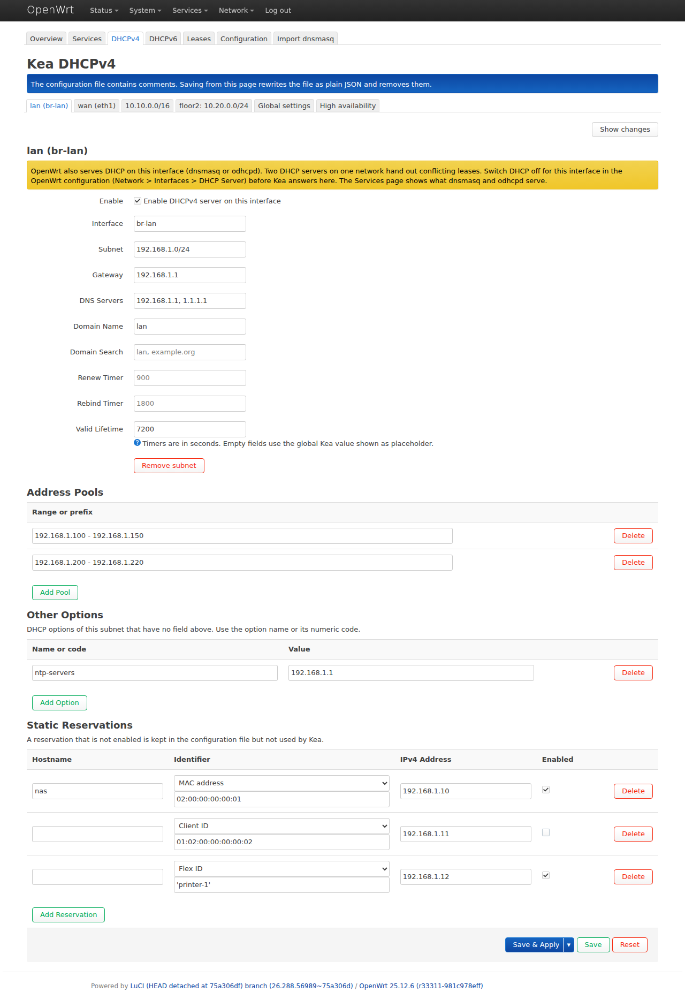
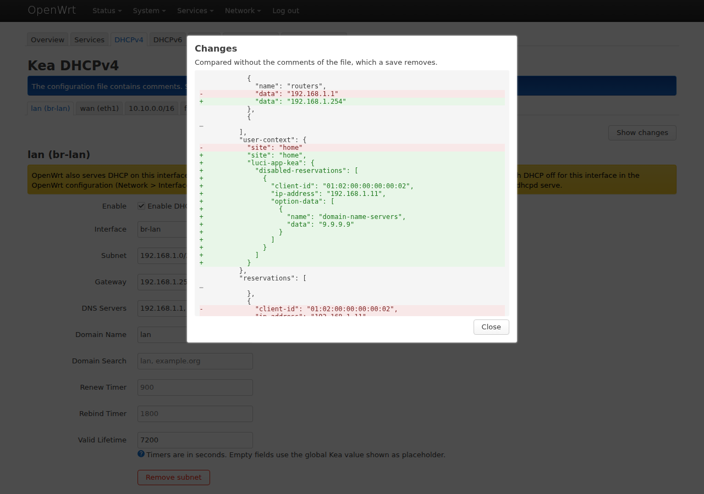
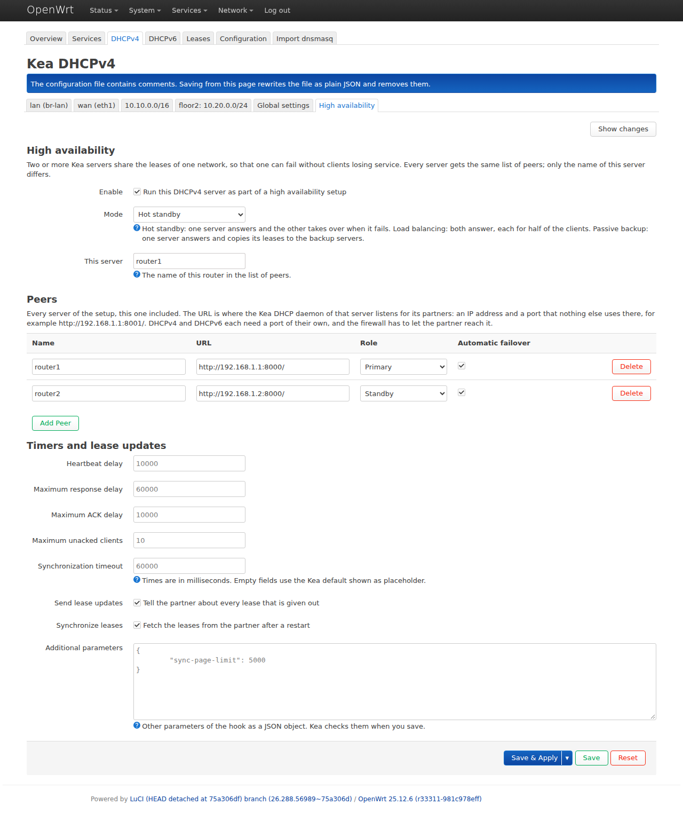
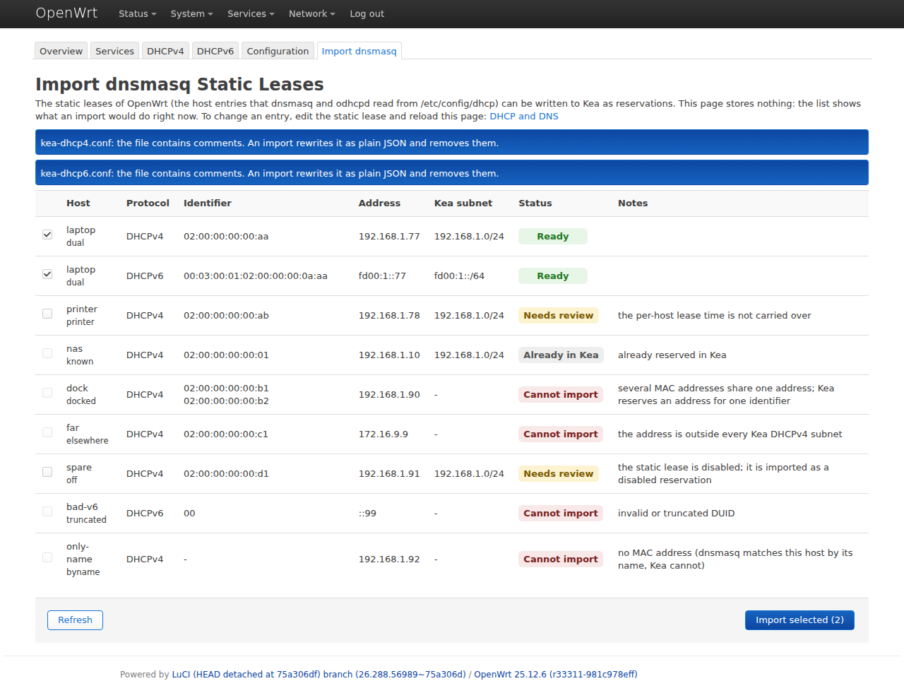
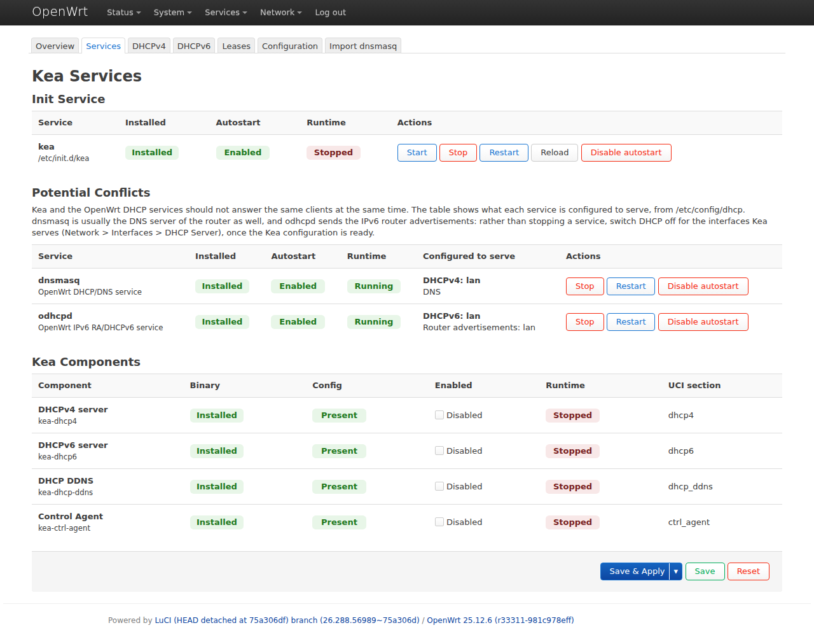

# luci-app-kea

[](https://github.com/woffko/luci-app-kea/actions/workflows/ci.yml)

LuCI application for managing the ISC Kea DHCP server on OpenWrt.

> **Status: alpha (0.11.0).** Usable for testing on a lab router. Not ready to
> replace a production dnsmasq/odhcpd setup yet: see
> [Known limitations](#known-limitations).

## Purpose

OpenWrt packages Kea but has no LuCI application for it. `kea-uci` only
provides on/off switches for the Kea daemons; subnets, pools, reservations and
everything else live in Kea's JSON files.

This application adds a LuCI interface for the common DHCP settings and keeps
the JSON files reachable for everything else.

It is developed as a standalone package for now, with a later submission to
[openwrt/luci](https://github.com/openwrt/luci) as the goal.

## Features

Menu location: **Services > Kea DHCP**.

- **Overview**: Kea version, installed components and hooks, config files,
  the result of checking each file, what the running DHCP daemons say about
  themselves (whether they listen, the state of high availability), the
  recent Kea messages of the system log, and where each daemon writes its
  log when that is somewhere else.
- **Services**: start, stop, restart, reload and autostart for the Kea init
  service; enable or disable `kea-dhcp4`, `kea-dhcp6`, `kea-dhcp-ddns` and
  `kea-ctrl-agent`; what `dnsmasq` and `odhcpd` are configured to serve,
  their state, and explicit controls for them.
- **DHCPv4**: one tab per interface or subnet with the subnet, its address
  pools, gateway, DNS servers, domain, timers, any other DHCP option, and
  reservations by MAC address, client ID, DUID, circuit ID or flex ID. A
  last tab holds the global timers, the lease file cleanup interval, the
  log output, the retries for the sockets and the options for all subnets.
- **DHCPv6**: the same with prefix delegation pools and reservations by
  DUID, MAC address or flex ID.
- **High availability**: a tab of the DHCPv4 and DHCPv6 pages when
  `kea-hook-ha` is installed. Hot standby, load balancing or passive backup,
  the peers with their roles, the timers, and every other parameter of the
  hook as JSON. With the `ha-cluster` package installed, the peers can be
  filled in from the nodes of the cluster, and `ha-cluster` is told to
  bring its firewall rules up to date when Kea takes a new configuration,
  so that the ports of the peer URLs stay open between the nodes.
- **Leases**: the DHCPv4 and DHCPv6 leases in use, with remaining time,
  read from the lease files of Kea.
- **Configuration**: raw editor for the four Kea config files, with a JSON
  syntax check and restore from backup.
- **Import dnsmasq**: turns the static leases of OpenWrt (`/etc/config/dhcp`)
  into Kea reservations for DHCPv4 and DHCPv6. The page shows what would
  happen to each lease and why, and you choose what to import. Scripts can
  run the same import with `/usr/libexec/luci-app-kea/import-dnsmasq`.

The DHCPv4 and DHCPv6 pages change only what you edit. Settings they do not
show (relay settings, client classes, hooks, extra keys of a pool or a
reservation and so on) stay in the file as they were. A reservation can be
switched off without deleting it.

A value Kea would refuse, such as a pool outside its subnet or a MAC address
written with dashes, is marked while you type, with the reason. **Show
changes** lists the lines of the file a save would change. The pages warn
when OpenWrt already serves DHCP on an interface you enable for Kea.

Every config write is validated with the Kea binary before the file is
replaced, for the DHCP daemons with their hook libraries loaded
(`kea-dhcp4 -T`), and the previous file is kept in
`/etc/kea/backups/` (the ten newest per file). **Save & Apply** also reloads
a running Kea daemon and tells you whether it is still running afterwards.

The check of Kea does not see everything. A lease file or a log file in a
directory Kea 3 does not allow passes it, and the daemon then does not
start. The application warns about these two settings wherever it shows the
result of the check, and asks before it reloads a running daemon with them.

A daemon that runs is not always one that listens. Started at boot before
its interface is ready, Kea opens no socket and stays that way unless it is
told to retry. The pages write those retries when they make Kea listen on
an interface, warn about a file without them, and show on Overview and
Services whether a running daemon has its sockets open.

## Screenshots

The DHCPv4 page. Each interface has a tab; a reservation can be switched off
without deleting it.



What a save would change, before it is made.



High availability for a pair of routers, on a tab of the same page when
`kea-hook-ha` is installed.



The import of OpenWrt static leases. Every lease gets a state and, where it
cannot be imported, the reason.



The Services page, with the OpenWrt DHCP services that would compete with
Kea and what they are configured to serve.



All pages are shown in [docs/SCREENSHOTS.md](docs/SCREENSHOTS.md).

## Known limitations

- Client classes, option definitions, hooks, loggers and shared networks
  themselves have to be edited on the Configuration page. The DHCPv4 and
  DHCPv6 pages preserve them, and edit the subnets inside shared networks.
- Saving from the DHCPv4 and DHCPv6 pages removes comments from the file. The
  page tells you when the file has any.
- The value of a DHCP option is checked by Kea, not by the form: a mistake
  there is reported when you save.
- The import cannot convert a static lease with several MAC addresses, and
  it does not carry over per-host lease times or dnsmasq tags. It tells you
  which leases are affected.
- High availability: one relationship per daemon; the form shows the
  configuration, not whether the partner is reachable. Each router is
  configured on its own.
- The Leases page is read only: it cannot remove a lease, and it does not
  show leases that ran out.
- English only.

The full list is in [docs/STATUS.md](docs/STATUS.md).

## Requirements

- OpenWrt with LuCI.
- At least one of `kea-dhcp4`, `kea-dhcp6`, `kea-dhcp-ddns`, `kea-ctrl` from
  the OpenWrt packages feed.

`kea-uci` and `kea-lfc` are installed as dependencies. `kea-lfc` is needed
because the configuration files shipped with Kea enable lease file cleanup,
and the DHCP daemons do not start without it.

Tested on OpenWrt 25.12.6 and 25.12.5 x86-64 with Kea 3.0.4 (November 2026).
Earlier versions were tested on OpenWrt 25.12.3 with Kea 3.0.2.

## Installation

The package is for OpenWrt 25.12 (`apk`). It contains no compiled code, so
the same file fits every router architecture.

### From a release

Download `luci-app-kea-<version>.apk` from the newest entry on the
[Releases page](https://github.com/woffko/luci-app-kea/releases). The
releases are marked as pre-releases while the application is alpha.

Copy the package to the router and install it there. The router fetches the
dependencies, `kea-uci` and `kea-lfc`, from the OpenWrt package
repositories:

```sh
scp -O luci-app-kea-*.apk root@192.168.1.1:/tmp/
ssh root@192.168.1.1
apk update
apk add kea-dhcp4 kea-dhcp6
apk add --allow-untrusted /tmp/luci-app-kea-*.apk
```

Install the Kea daemons you want; `kea-dhcp4` and `kea-dhcp6` above are an
example. `kea-hook-ha` adds the high availability tab. Then reload LuCI:
**Kea DHCP** is under **Services**.

A freshly installed Kea daemon is switched off in `/etc/config/kea` and
does not start; the application starts nothing on its own either. The
daemons are switched on on the **Services** page. Read
[Before you use it](#before-you-use-it) first.

To upgrade, install a newer package the same way. `apk del luci-app-kea`
removes the application; the Kea configuration and the backups in
`/etc/kea/backups/` stay.

### The development version

Every CI run on `main` keeps the package it built for 90 days. It is what
the next release will be made from. Downloading it needs a GitHub account.

In the browser: open
[the CI runs of `main`](https://github.com/woffko/luci-app-kea/actions/workflows/ci.yml?query=branch%3Amain),
choose the newest run with a green mark, and download `luci-app-kea` under
**Artifacts**. It is a zip file with the package inside.

Or with the [GitHub CLI](https://cli.github.com/):

```sh
run=$(gh run list --repo woffko/luci-app-kea --workflow CI --branch main \
        --status success --limit 1 --json databaseId --jq '.[0].databaseId')
gh run download "$run" --repo woffko/luci-app-kea --name luci-app-kea --dir .
```

Install it like a release.

### Building it yourself

The repository is an OpenWrt feed. In an OpenWrt tree that has the `luci`
and `packages` feeds, add it to `feeds.conf`:

```sh
cd /path/to/openwrt
[ -f feeds.conf ] || cp feeds.conf.default feeds.conf
echo "src-git kea https://github.com/woffko/luci-app-kea.git" >> feeds.conf
./scripts/feeds update -a
./scripts/feeds install -a
make menuconfig
make package/luci-app-kea/compile V=s
```

In menuconfig, select a Kea daemon under **Network > IP Addresses and Names**
first. `luci-app-kea` appears under **LuCI > 3. Applications** only after
that.

The package is written to `bin/packages/<arch>/kea/`. Copy it to the router
and install it as above. `./scripts/feeds update kea` fetches a newer
version later.

The feed line above builds the development version. To build a release,
append its tag: `...luci-app-kea.git;<tag>`. This works for releases after
`v0.7.0`; up to that tag the package is at the root of the repository,
where the feed scripts do not find it.

## Before you use it

- Back up `/etc/config/dhcp`, `/etc/config/kea` and `/etc/kea/*.conf`.
- Do not run Kea and dnsmasq/odhcpd as DHCP servers on the same interface.
  The application shows the state of both and never stops them on its own.
- Leave the lease file where Kea puts it. Kea 3.0 accepts a lease file only
  in `/var/lib/kea` and a log file only in `/var/log/kea`. Another directory
  passes the check of the configuration, and the daemon then does not
  start. The application warns about it.
- To see the messages of Kea on the **Overview** page, set **Log Output** to
  the system log on the Global settings tab of the DHCPv4 and DHCPv6 pages.
  The configuration files shipped with Kea name a log file in a directory
  that OpenWrt does not have, and what is written there is lost. Overview
  says so when that is the case.
- Give Kea time to find its interface at boot: set **Socket Retries** and
  **Socket Retry Wait** on the Global settings tab of the DHCPv4 and DHCPv6
  pages, for example 60 and 2000. The pages do it themselves when they make
  Kea listen on an interface; a file made elsewhere may lack them, and the
  application then warns. Without them a Kea that is started before the
  interface is ready keeps running and never listens.
- For DHCPv6, the server has a new identifier after every boot, because Kea
  keeps it in `/var/lib/kea`, which is in memory. Clients keep their
  addresses: they renew a little later than they would. A fixed identifier
  (`server-id` in the file, on the **Configuration** page) avoids it; the
  application does not write one. [STATUS.md](docs/STATUS.md#kea-at-boot-and-at-run-time)
  has the measurements.
- Do not stop dnsmasq to make room for Kea: on most routers it is also the
  DNS server. Switch its DHCP off for the interfaces Kea serves. The
  **Services** page shows what dnsmasq and odhcpd serve.
- A LuCI login other than root needs the ACL groups `unauthenticated`,
  `luci-base` and `luci-app-kea` in `/etc/config/rpcd`. With
  `luci-app-kea` alone, LuCI says that the login session expired.

## Documentation

- [CHANGELOG.md](CHANGELOG.md): what changed in each version.
- [docs/SCREENSHOTS.md](docs/SCREENSHOTS.md): every page.
- [docs/STATUS.md](docs/STATUS.md): what is implemented, known defects, what
  is missing.
- [docs/ROADMAP.md](docs/ROADMAP.md): the work plan and open questions.
- [docs/PACKAGING.md](docs/PACKAGING.md): conformance with the OpenWrt and
  LuCI packaging rules.
- [docs/DESIGN.md](docs/DESIGN.md): intended behavior of each feature.
- [docs/DEVELOPMENT.md](docs/DEVELOPMENT.md): building, deploying to a test
  target, checks, debugging.
- [docs/RELEASING.md](docs/RELEASING.md): version numbers and how a release
  is made.
- [docs/HISTORY.md](docs/HISTORY.md): development log.

## License

Apache-2.0.
