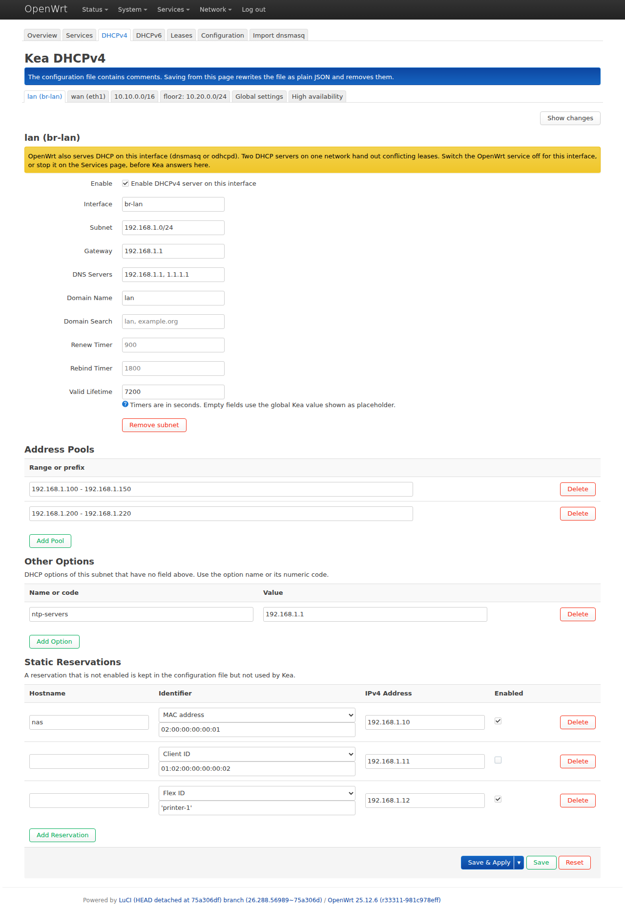
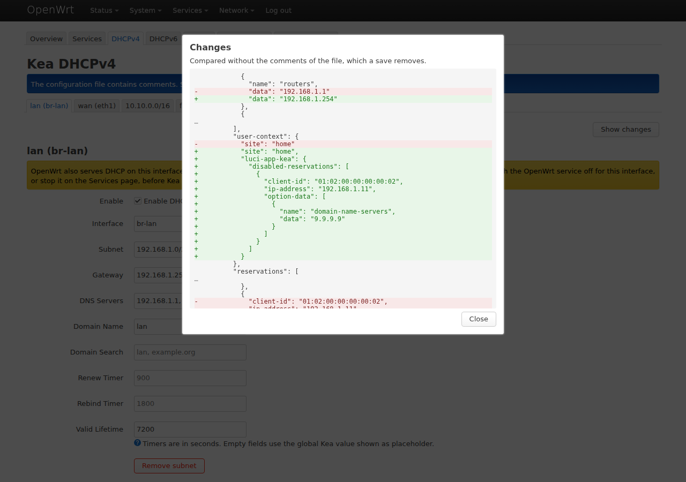
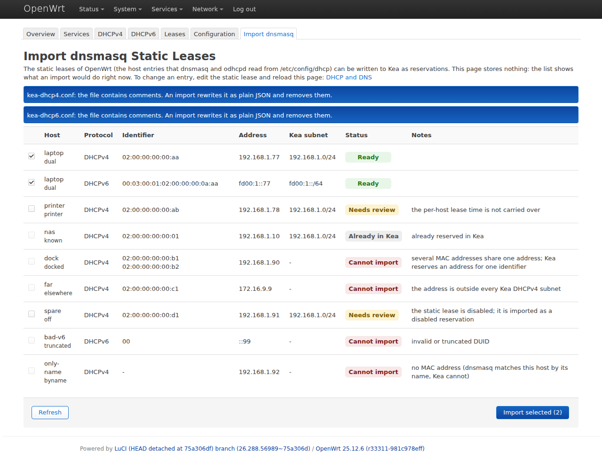
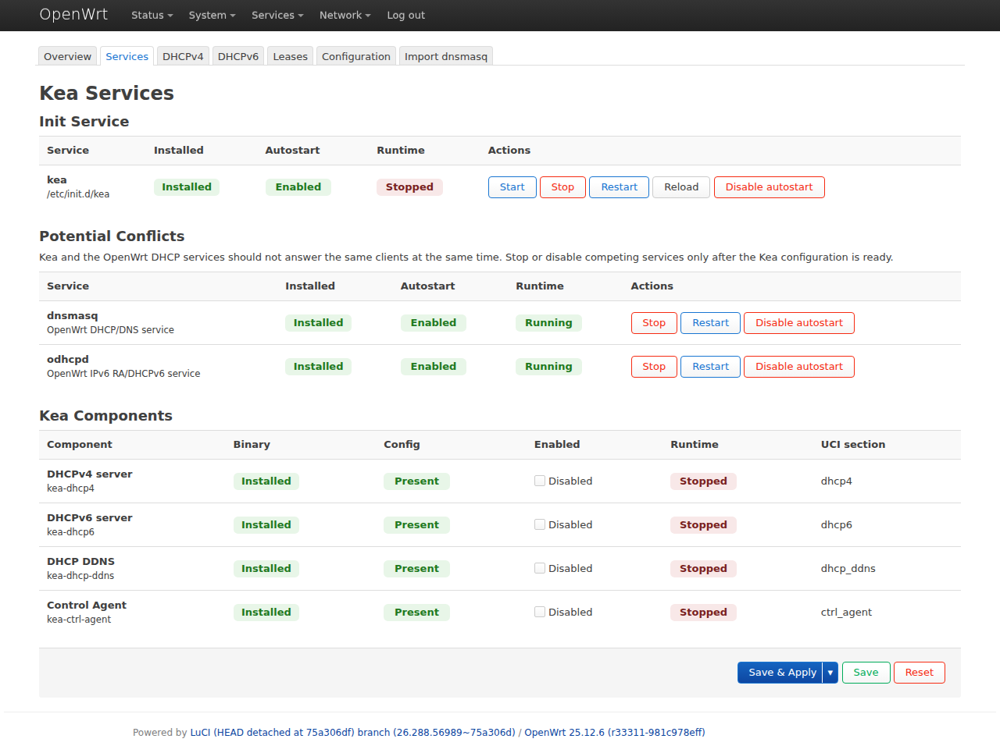

# luci-app-kea

[](https://github.com/woffko/luci-app-kea/actions/workflows/ci.yml)

LuCI application for managing the ISC Kea DHCP server on OpenWrt.

> **Status: alpha (0.7.0).** Usable for testing on a lab router. Not ready to
> replace a production dnsmasq/odhcpd setup yet: see
> [Known limitations](#known-limitations).

## Purpose

OpenWrt packages Kea but has no LuCI application for it. `kea-uci` only
provides on/off switches for the Kea daemons; subnets, pools, reservations and
everything else live in Kea's JSON files.

This application adds a LuCI interface for the common DHCP settings and keeps
the JSON files reachable for everything else.

It is developed as a standalone package for now, with a later submission to
[openwrt/luci](https://github.com/openwrt/luci) as the goal.

## Features

Menu location: **Services > Kea DHCP**.

- **Overview**: Kea version, installed components and hooks, config files,
  the result of checking each file, and the recent Kea messages of the
  system log.
- **Services**: start, stop, restart, reload and autostart for the Kea init
  service; enable or disable `kea-dhcp4`, `kea-dhcp6`, `kea-dhcp-ddns` and
  `kea-ctrl-agent`; state and explicit controls for `dnsmasq` and `odhcpd`.
- **DHCPv4**: one tab per interface or subnet with the subnet, its address
  pools, gateway, DNS servers, domain, timers, any other DHCP option, and
  reservations by MAC address, client ID, DUID, circuit ID or flex ID. A
  last tab holds the global timers, the lease file cleanup interval and the
  options for all subnets.
- **DHCPv6**: the same with prefix delegation pools and reservations by
  DUID, MAC address or flex ID.
- **High availability**: a tab of the DHCPv4 and DHCPv6 pages when
  `kea-hook-ha` is installed. Hot standby, load balancing or passive backup,
  the peers with their roles, the timers, and every other parameter of the
  hook as JSON.
- **Leases**: the DHCPv4 and DHCPv6 leases in use, with remaining time,
  read from the lease files of Kea.
- **Configuration**: raw editor for the four Kea config files, with a JSON
  syntax check and restore from backup.
- **Import dnsmasq**: turns the static leases of OpenWrt (`/etc/config/dhcp`)
  into Kea reservations for DHCPv4 and DHCPv6. The page shows what would
  happen to each lease and why, and you choose what to import.

The DHCPv4 and DHCPv6 pages change only what you edit. Settings they do not
show (relay settings, client classes, hooks, extra keys of a pool or a
reservation and so on) stay in the file as they were. A reservation can be
switched off without deleting it.

A value Kea would refuse, such as a pool outside its subnet or a MAC address
written with dashes, is marked while you type, with the reason. **Show
changes** lists the lines of the file a save would change. The pages warn
when OpenWrt already serves DHCP on an interface you enable for Kea.

Every config write is validated with the Kea binary before the file is
replaced, for the DHCP daemons with their hook libraries loaded
(`kea-dhcp4 -T`), and the previous file is kept in
`/etc/kea/backups/` (the ten newest per file). **Save & Apply** also reloads
a running Kea daemon and tells you whether it is still running afterwards.

## Screenshots

The DHCPv4 page. Each interface has a tab; a reservation can be switched off
without deleting it.



What a save would change, before it is made.



The import of OpenWrt static leases. Every lease gets a state and, where it
cannot be imported, the reason.



The Services page, with the OpenWrt DHCP services that would compete with
Kea.



All pages are shown in [docs/SCREENSHOTS.md](docs/SCREENSHOTS.md).

## Known limitations

- Client classes, option definitions, hooks, loggers and shared networks
  themselves have to be edited on the Configuration page. The DHCPv4 and
  DHCPv6 pages preserve them, and edit the subnets inside shared networks.
- Saving from the DHCPv4 and DHCPv6 pages removes comments from the file. The
  page tells you when the file has any.
- The value of a DHCP option is checked by Kea, not by the form: a mistake
  there is reported when you save.
- The import cannot convert a static lease with several MAC addresses, and
  it does not carry over per-host lease times or dnsmasq tags. It tells you
  which leases are affected.
- High availability: one relationship per daemon; the form shows the
  configuration, not whether the partner is reachable. Each router is
  configured on its own.
- The Leases page is read only: it cannot remove a lease, and it does not
  show leases that ran out.
- English only.

The full list is in [docs/STATUS.md](docs/STATUS.md).

## Requirements

- OpenWrt with LuCI.
- At least one of `kea-dhcp4`, `kea-dhcp6`, `kea-dhcp-ddns`, `kea-ctrl` from
  the OpenWrt packages feed.

`kea-uci` and `kea-lfc` are installed as dependencies. `kea-lfc` is needed
because the configuration files shipped with Kea enable lease file cleanup,
and the DHCP daemons do not start without it.

Tested on OpenWrt 25.12.6 and 25.12.5 x86-64 with Kea 3.0.4 (November 2026).
Earlier versions were tested on OpenWrt 25.12.3 with Kea 3.0.2.

## Installation

There are no releases yet. Every CI run on `main` attaches a built package
as an artifact; to build it yourself, use an OpenWrt tree that has the `luci`
and `packages` feeds installed:

```sh
cd /path/to/openwrt
git clone https://github.com/woffko/luci-app-kea.git package/luci-app-kea
./scripts/feeds update -a
./scripts/feeds install -a
make menuconfig
make package/luci-app-kea/compile V=s
```

In menuconfig, select a Kea daemon under **Network > IP Addresses and Names**
first. `luci-app-kea` appears under **LuCI > 3. Applications** only after
that.

Copy the resulting package to the router and install it:

```sh
apk add --allow-untrusted /tmp/luci-app-kea-*.apk
```

## Before you use it

- Back up `/etc/config/dhcp`, `/etc/config/kea` and `/etc/kea/*.conf`.
- Do not run Kea and dnsmasq/odhcpd as DHCP servers on the same interface.
  The application shows the state of both and never stops them on its own.

## Documentation

- [docs/SCREENSHOTS.md](docs/SCREENSHOTS.md): every page.
- [docs/STATUS.md](docs/STATUS.md): what is implemented, known defects, what
  is missing.
- [docs/ROADMAP.md](docs/ROADMAP.md): the work plan and open questions.
- [docs/PACKAGING.md](docs/PACKAGING.md): conformance with the OpenWrt and
  LuCI packaging rules.
- [docs/DESIGN.md](docs/DESIGN.md): intended behavior of each feature.
- [docs/DEVELOPMENT.md](docs/DEVELOPMENT.md): building, deploying to a test
  target, checks, debugging.
- [docs/HISTORY.md](docs/HISTORY.md): development log.

## License

Apache-2.0.
