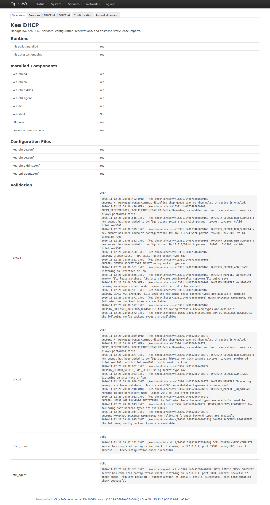
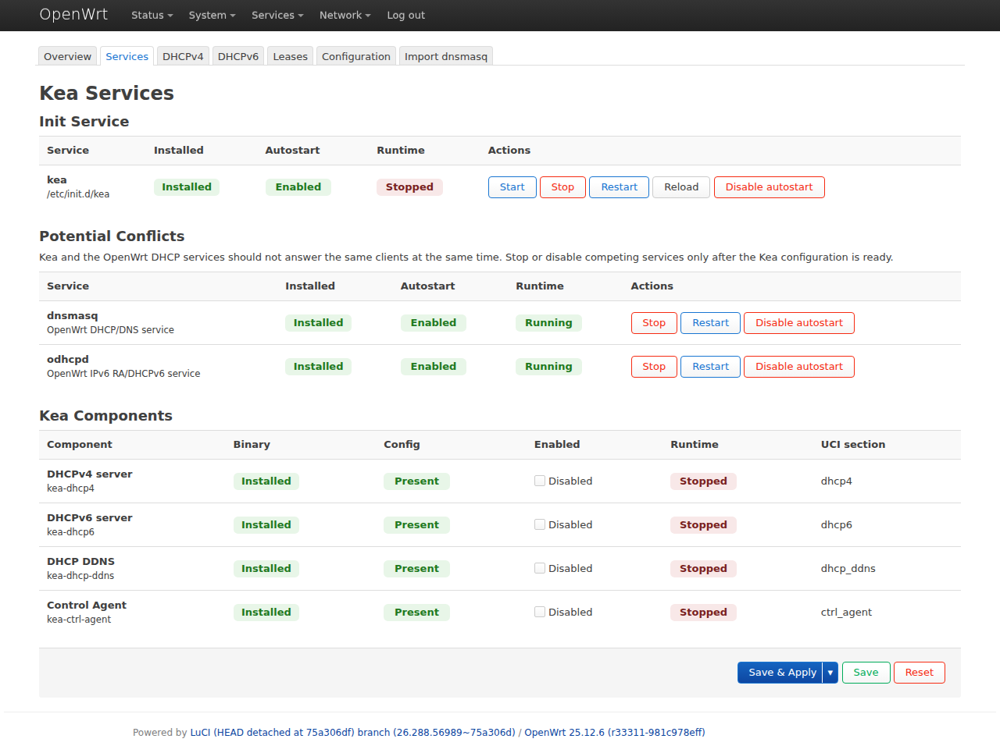
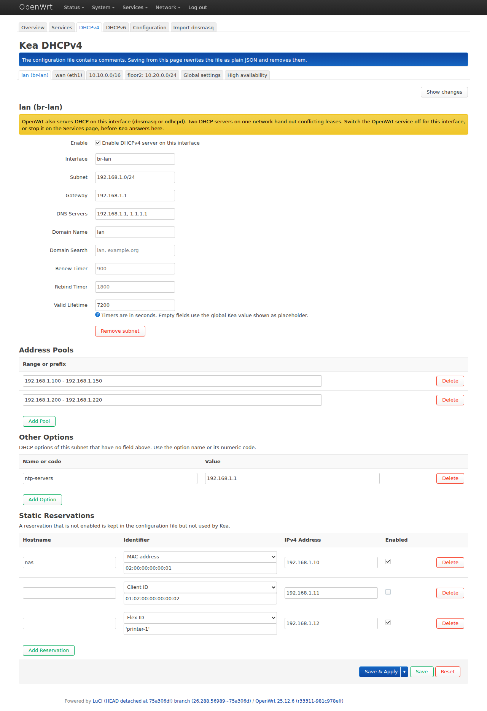
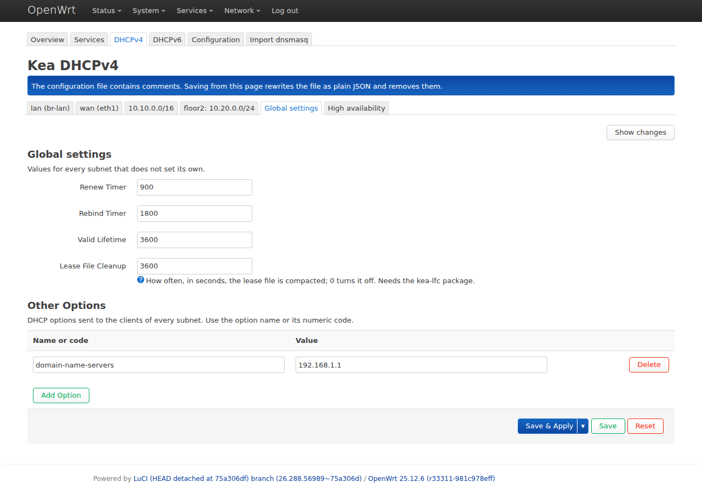
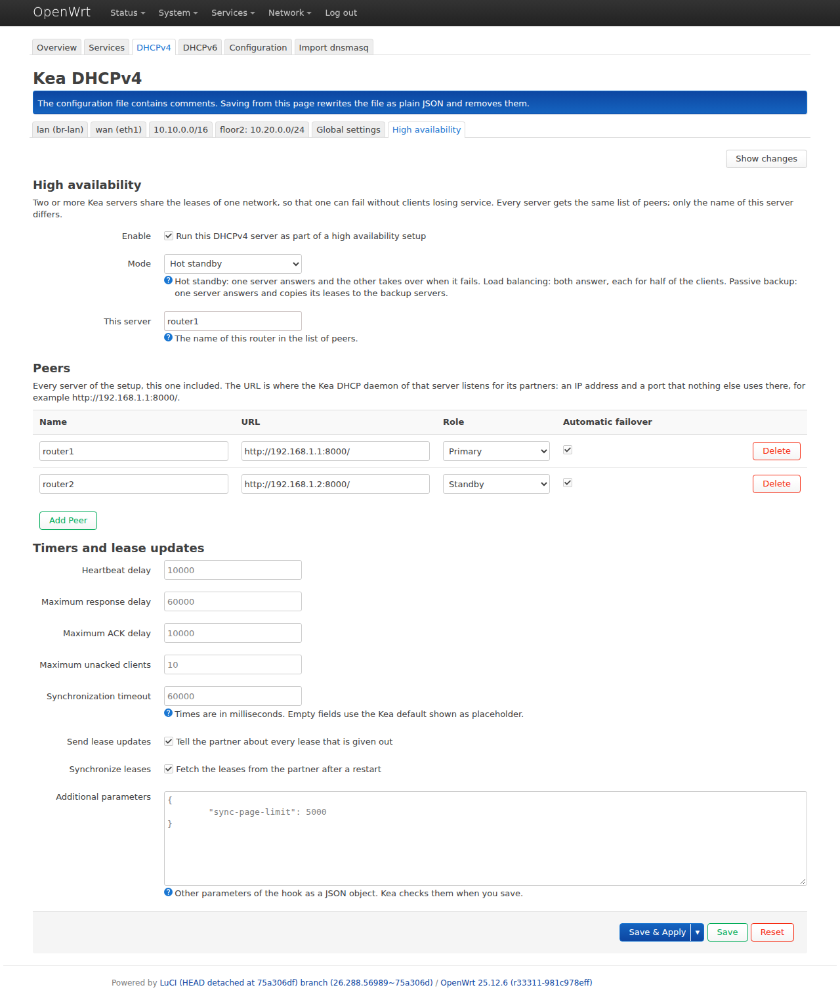
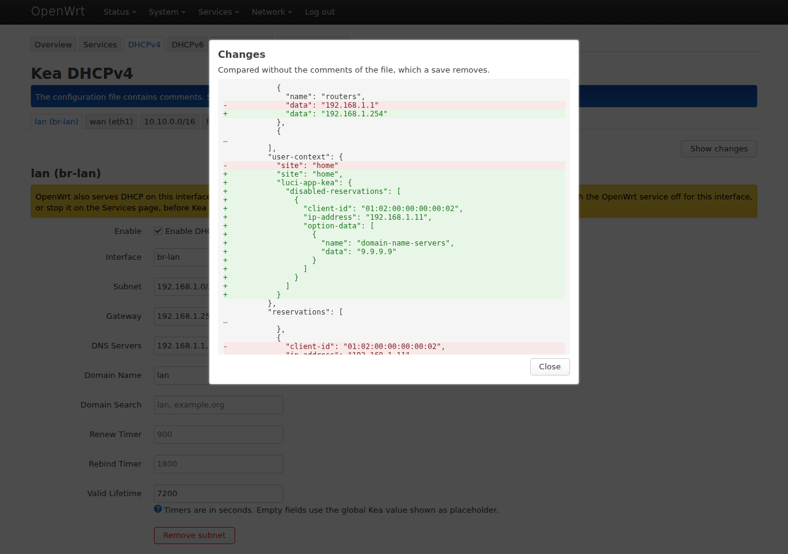
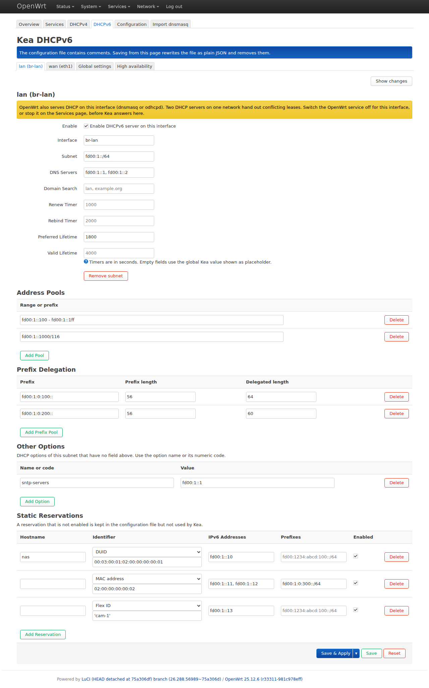
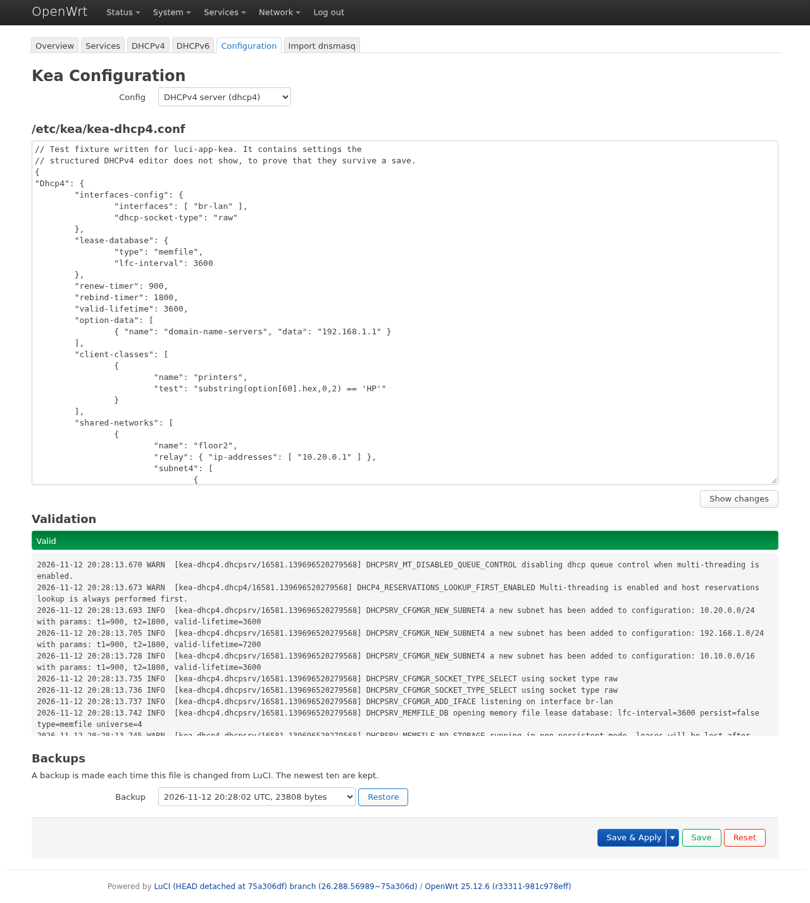
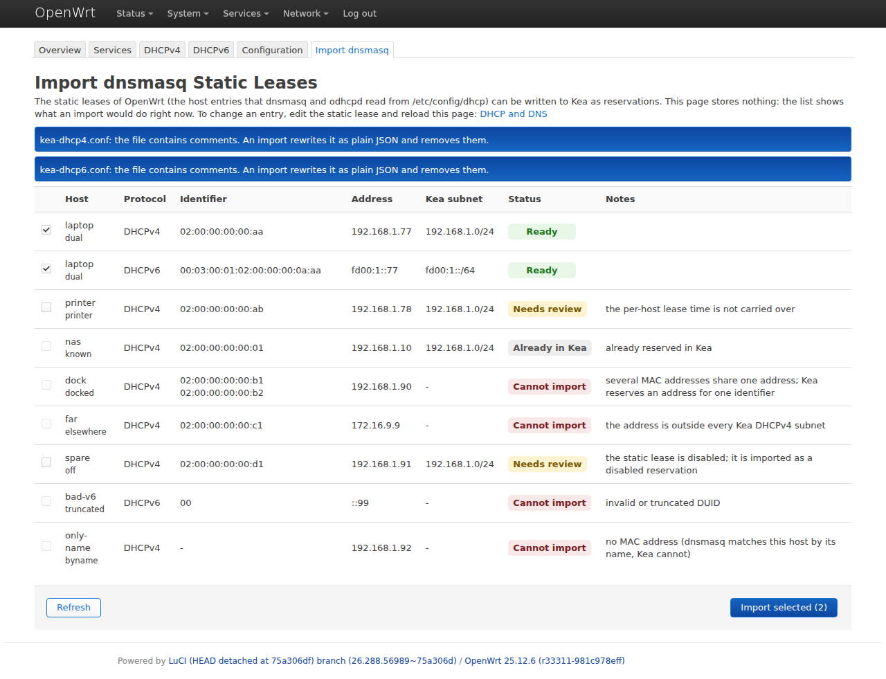

# Screenshots

Taken with version `0.6.0` on OpenWrt 25.12.6 with Kea 3.0.4, using the test
fixtures of this repository as configuration. `test/browser/screenshots.js`
regenerates them; see [DEVELOPMENT.md](DEVELOPMENT.md#screenshots).

## Overview

Installed Kea components, configuration files, and the result of validating
each file with its Kea daemon.

## Services

The Kea init service, the DHCP services of OpenWrt that would compete with
Kea, and the Kea components with their enable switches.

## DHCPv4

One tab per interface, one per subnet that is not bound to an interface
(here the relayed subnet `10.10.0.0/16`) and one per subnet of a shared
network (`floor2`). The subnet has two address pools and one option besides
the ones with a field of their own. The second reservation is switched off:
it stays in the file but Kea does not use it. The warning is there because
dnsmasq serves DHCP on the same interface of the test machine.

## Global settings

The last tab: timers and lifetimes for every subnet that does not set its
own, the lease file cleanup interval, and the options sent to every subnet.

## High availability

The tab appears when `kea-hook-ha` is installed. A hot standby pair, as it is
typed in on the first of the two routers.

## Changes before saving

**Show changes** lists the lines of the file that a save would change. Here
the gateway was changed and one reservation switched off, which moves it
into the subnet's `user-context`.

## DHCPv6

The same editor for DHCPv6, with prefix delegation pools and reservations by
DUID, MAC address and flex ID.

## Configuration

The raw editor with the validation result and the backups of the selected
file. A JSON syntax error is reported under the text while typing.

## Import dnsmasq

What an import of the OpenWrt static leases would do: one row per lease and
protocol, with its state and the reason when a lease cannot be imported.

